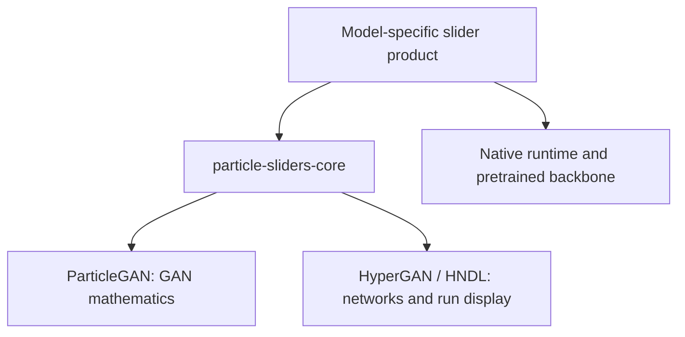

# particle-sliders

**Sliders for generative models: turn one concept up or down with a number.**
A slider is a small adapter trained on a frozen model. At strength 0 the model
is unchanged; at strength 1 it applies one learned edit, such as a female voice,
a metal arrangement or a lighting style. Music comes first here: YuE2 and
MiniMax Music 3 generate songs from a style caption and lyrics. Image and video
backends follow.

This repository also ships
[`particle-sliders-core`](packages/particle-sliders-core), the shared dependency
for model-specific slider products. The intended common base covers image,
music, audio and video models, including Anima, Krea, YuE2, MOSS and Sana.
Integration status varies by model and source pin.

**Current public source:** `main` contains core0.8.3 with the shared lifecycle,
native-only inference and exact official ParticleGAN0.9.1. This branch proposes
core0.11.0/officialPG0.9.3 with eligible dense Gram enabled by default; it is
not yet merged or a package release. Historical stamp/FormulationGame helpers
remain available within their documented limits. Existing sliders retain their
own exact release recipes and loaders.
See [Architecture and availability](#architecture-and-availability) before choosing
an integration path.

| I want to… | Start here |
|---|---|
| Hear or use a published slider | [Listen](#listen) |
| Choose the common-base architecture and check availability | [Architecture and availability](#architecture-and-availability) |
| Use the current public shared-core API | [Use the shared core](#use-the-shared-core) |
| Train a new slider on a supported model | [Train a slider](#train-a-slider) |
| Run the tests | [Tests](#tests) |
| Understand the math and the evidence | [docs/math.md](docs/math.md) |
| Find a backend guide, prompt file or experiment write-up | [docs/README.md](docs/README.md) |

## Listen

| Project | Hugging Face links |
|---|---|
| **YuE2** · routed particles | [Project / weights](https://huggingface.co/ntc-ai/yue2-concept-sliders) · [Live demo](https://huggingface.co/spaces/ntc-ai/yue2-concept-sliders) · [Listening gallery](https://huggingface.co/ntc-ai/yue2-concept-sliders#press-play--original-particles) |
| **Music 3** · LM LoRA | [Project / weights](https://huggingface.co/ntc-ai/minimax-music3-concept-sliders) · [Live demo](https://huggingface.co/spaces/ntc-ai/minimax-music3-concept-sliders) · [Listening gallery](https://huggingface.co/ntc-ai/minimax-music3-concept-sliders#press-play) |
| **Anima** · images | [Candlelit / Moonlit samples](https://huggingface.co/ntc-ai/anima-concept-sliders) |

Each Off/On pair below uses the same neutral caption, lyrics and seed. Only
the slider strength changes. These are short, token-capped YuE2 excerpts from
the September 17 `particle-1200-v1` export. The full gallery also has half
strength and positive-caption references.

| Control | Matched MP3 samples |
|---|---|
| Female voice | [Off](https://huggingface.co/ntc-ai/yue2-concept-sliders/resolve/main/samples/particle-1200-v1/female/row0-seed1709-off.mp3) · [On (+1)](https://huggingface.co/ntc-ai/yue2-concept-sliders/resolve/main/samples/particle-1200-v1/female/row0-seed1709-on.mp3) |
| Metal | [Off](https://huggingface.co/ntc-ai/yue2-concept-sliders/resolve/main/samples/particle-1200-v1/metal/row0-seed1709-off.mp3) · [On (+1)](https://huggingface.co/ntc-ai/yue2-concept-sliders/resolve/main/samples/particle-1200-v1/metal/row0-seed1709-on.mp3) |
| House | [Off](https://huggingface.co/ntc-ai/yue2-concept-sliders/resolve/main/samples/particle-1200-v1/house/row0-seed1709-off.mp3) · [On (+1)](https://huggingface.co/ntc-ai/yue2-concept-sliders/resolve/main/samples/particle-1200-v1/house/row0-seed1709-on.mp3) |

Both music projects publish the same **16 voice and genre controls**, with
four matched Off/On comparisons each: female, male, lo-fi, pop, hip-hop, R&B,
indie rock, pop punk, metal, country, acoustic folk, house, disco funk, K-pop,
reggaeton and afrobeats.

### Use a published slider

- **YuE2.** Try the live demo, or download the
  [native particle weights](https://huggingface.co/ntc-ai/yue2-concept-sliders/tree/main/weights/particle-1200-v1)
  and render them with `infer_yue2.py` (YuE2 environment and a GPU; see
  [YuE2](#yue2)). The demo and samples use these native particles. Tools that
  only load standard LoRAs need the distilled LoRAs, which are an approximation;
  see the [distillation guide](https://huggingface.co/ntc-ai/yue2-concept-sliders/blob/main/DISTILLATION.md).
  The same Hub project also records the later `particle-gmix-1600-v2` run that
  the shared core is pinned to.
- **Music 3.** Follow the
  [native loading example](https://huggingface.co/ntc-ai/minimax-music3-concept-sliders/blob/main/usage.md)
  or the [ComfyUI guide](https://huggingface.co/ntc-ai/minimax-music3-concept-sliders/blob/main/comfyui/README.md).
  Keep each native `.safetensors` next to its JSON sidecar. In ComfyUI the
  released LM adapters apply to the text encoder/CLIP side. The September 16
  release has 16 unipolar rank-8 LM adapters, ComfyUI conversions and 64
  matched Off/On comparisons. Its
  [release card](https://huggingface.co/ntc-ai/minimax-music3-concept-sliders)
  records the per-control checkpoint choices (1,000 to 3,400 updates) and
  limitations.

Start with one adapter at strengths 0 and 1.

## Architecture and availability

The dependency direction is **model product → particle-sliders → upstream
HyperGAN / ParticleGAN**. Products should install a reviewed core pin and provide
thin native adapters. They should not vendor a second GAN implementation or make
the shared core import product packages. This is the architecture contract for
the ongoing migration; it does not mean every backend has migrated.



| Owner | Responsibility |
|---|---|
| Model product | Verified native loading, projection/packing geometry, tokenization or scheduler behavior, native admission checks, sampling callbacks and model-specific user inputs. |
| `particle-sliders-core` | Shared configuration/capabilities and complete lifecycle orchestration: preparation, steps, checkpoint/resume, EMA selection, evaluation, export and inference entrypoints. This complete lifecycle is under review. |
| [ParticleGAN](https://github.com/255BITS/ParticleGAN) | GAN objectives, regularizers, prior and optimizer mathematics. A product or core integration calls the upstream API and preserves its exact formulation/profile. |
| [HyperGAN](https://github.com/HyperGAN/HyperGAN) / HNDL | Network definitions and run reporting/display. Matched-weight network migration and reporting integration are separate work; pretrained native backbones keep their native boundary. |

The intended consumer flow is to select a registered model backend and its local
configuration, then use shared train/resume/evaluate/export/inference operations.
The product's complete factory owns native object construction and cleanup. This source revision includes
the lifecycle entrypoints described in the [package guide](packages/particle-sliders-core/README.md).
Install a full reviewed source pin and the product with its matching instructions;
this change does not publish a package or qualify pretrained/native behavior.

Common interfaces do not require co-installing incompatible native libraries.
Keep each product's tested environment and runtime lock; Qwen Image and Fibo, for
example, can require different Diffusers revisions. Preserve legitimate model
arms: Krea2's adapter-only GAN has no routed particle bank, while routed models
must use their actual participating bank. Iris's PG rendering route remains gated
pending native solver parity. A hidden response is not an image or waveform.

### Modern PG0.9.3/Gram source candidate

This branch proposes core0.11.0 with exact officialPG0.9.3 and a supported
upstream Gram default. See [the modernization contract](packages/particle-sliders-core/MODERN-GRAM.md).
It is a new reviewed-cohort target; the prior merged091 API, release receipts
and product pins below remain historical and unchanged until explicit adoption.
No package release, native activation or old-checkpoint rebinding is implied.

### Previously merged PG0.9.1 API and preserved qualification

The previously merged source line provides **core0.8.3**, exact official `particlegan==0.9.1`
and Torch>=2.6,<3. It integrates the reviewed lifecycle history from a clean
main-based branch; it does not merge the unrelated audit/campaign stack. See
[legacy migration](packages/particle-sliders-core/LEGACY-MIGRATION.md) for
preserved stamp fields/imports/constructors and the explicit limits of retired
regularizer kernels. The original core0.3.0/ParticleGAN82b726 API remains at
[`17cd484`](https://github.com/HyperGAN/particle-sliders/tree/17cd484ef00601389256a30f6d52fc79991bcb3d).
No existing checkpoint or result receipt is rebound to a different source pin.

| Source cohort | Exact ParticleGAN dependency | Boundary |
|---|---|---|
| Preserved core0.8.3 line and reviewed core0.8.1/0.8.2 ancestors | `particlegan==0.9.1` | Shared image/numerical response lifecycle; keep each product's tested exact commit. No package release implied. |
| Separate core0.10.0 review line | `particlegan==0.9.3` | Later research/MOSS contract; not an automatic replacement for PG0.9.1 cohorts. |
| Original core0.3.0 at17cd484 | ParticleGAN Git82b726 | Exact old environment for retired regularizer kernels/class identity and historical receipts. |

Installed CPU evidence exists for six image products (Anima, Krea2, Supra, Iris,
Qwen Image and Fibo) and two numerical response products (Music3/YuE2), each at
its own exact source pin. Seven product source integrations have merged independently; Qwen Image remains
a separate draft review. None of those older tested product pins is upgraded
by this common-core proposal. MOSS has31 installed packaging/session checks on its separate officialPG0.9.3
line, with native sampling and compact inference still gated; Ming has no native
implementation and declares unsupported
operations. Sana's shared-repository migration is separate work. See the
[qualification boundaries](docs/stable-lane-qualification.md).

CPU fixtures establish updates, strict restore, raw/EMA exports, observation
isolation and data-free inference loading. They do not establish pretrained
quality, waveform generation, accelerator admission or completion of every
backend migration. Iris's native PG image rendering remains disabled pending
FlowDPMSolver parity; Krea2 remains adapter-only. Qwen and Fibo keep their own
native sampler, reference packing and isolated Diffusers environments.

Official released auto profiles still refuse native wide continuous Music3/YuE2
hidden responses. Explicit continuous-domain upstream work is an **unofficial
separate proposal**, neither included nor activated here. Published samples above
retain their original receipts and are not qualification of this lifecycle.

Historical [shared-core PR141](https://github.com/HyperGAN/particle-sliders/pull/141)
and [Fibo integration PR142](https://github.com/HyperGAN/particle-sliders/pull/142)
retain their audit targets. Derivative reviews include
[Iris PR1](https://github.com/HyperGAN/iris-particle-sliders/pull/1),
[Krea2 PR4](https://github.com/HyperGAN/krea2-particle-sliders/pull/4),
[Qwen Image PR1](https://github.com/HyperGAN/qwen-image-particle-sliders/pull/1) and
[Fibo PR1](https://github.com/HyperGAN/Fibo-particle-slider/pull/1).

## How it works

This section describes the historical published paths and the preserved stamp API.
The newer lifecycle preserves each backend's declared formulation and capability.

Each adapted layer becomes $f_s(x)=f_0(x)+s\,\Delta(x)$. Here
$f_0$ is the frozen layer, $\Delta$ is the learned correction and $s$ is the
slider strength. The preferred formulation, first used for YuE2, builds
$\Delta$ from a **routed particle cloud**. Each input picks a soft mixture of
learned vectors, and that mixture conditions a small nonlinear branch. Because
routing stays active at inference, these weights cannot be merged into an
ordinary LoRA.

The preferred formulation trains through a **paired-error adversarial game**.
A frozen teacher reads a positive caption, such as "female vocal", and the
adapted model reads the neutral caption. A critic sees shared noise, alone or
plus the student–teacher error, and the adapter learns to make the two
indistinguishable. There is no output MSE, feature matching, lyric hold or
ending loss. Only a critic gradient cap and a particle variance/covariance
regularizer are added. The game draws on
[ParticleGAN](https://github.com/255BITS/ParticleGAN). The released Music 3 LM
sliders use an earlier span-GAN that adds feature matching and ending
supervision.

[docs/math.md](docs/math.md) has the full equations, the published YuE2
release settings, the archived training curves and the older LoRA, diffusion
and language-model objectives used by the other backends.

## Use the shared core

For the **preserved historical stamp API**, pin `particle-sliders-core` and use
`winning_formulation()` / `FormulationGame` rather than copying the stamp's game.
The older [product follow-ups](docs/winning-formulation.md#product-follow-ups)
describe that migration's scope; they are not a completion report for the newer
lifecycle candidates. Install your product's tested PyTorch build first, then pin
a full reviewed commit of this repository. The git revision, not the package
version alone, identifies the stamp. Keep the transitive ParticleGAN pin from
that source; substituting a newer upstream release changes the contract.

```bash
python -m pip install \
  "particle-sliders-core @ git+https://github.com/HyperGAN/particle-sliders.git@17cd484ef00601389256a30f6d52fc79991bcb3d#subdirectory=packages/particle-sliders-core"
```

```python
from particle_sliders import winning_formulation, FormulationGame

stamp = winning_formulation()
config = {**stamp.as_dict(), "g_lr": 2e-5}  # only stamp.model_surface_keys may differ
stamp.require(config)                       # raises if a formulation key drifts

# targets / neutrals: [N, rank] paired positive and neutral features from your model
game = FormulationGame(stamp, config, critic_targets=targets, critic_neutrals=neutrals)
for step in range(1, steps + 1):            # steps count from 1
    stats = game.step(step, features)       # features: [batch, stamp.spec["adapter_rank"]]
```

This pinned stamp fixes its gmix architecture and declares the historical
`particle-gmix-1600-v2` tuning overlay. [ParticleGAN #38](https://github.com/255BITS/ParticleGAN/pull/38)
has since merged; a newer upstream default does not change this already-pinned
stamp or migrate its results. Adopt new settings through an explicit reviewed
pin/cohort. The runnable reference for this public API is
[test_formulation_game.py](packages/particle-sliders-core/tests/test_formulation_game.py).

- [Package README](packages/particle-sliders-core/README.md): install, API and `FormulationGame` train step
- [Winning formulation](docs/winning-formulation.md): the product stamp and what products may override
- [Shared ownership](docs/shared-core.md): product factories, common lifecycle and upstream boundaries


For new products, use [the lifecycle guide](packages/particle-sliders-core/README.md):
install the full reviewed core/product pins in one backend environment, then call
shared train/resume/evaluate/export/inference with that product's local options.
The complete offline [numerical response example](examples/response_fixture/README.md)
needs only two local text files; consumers never assemble a game/critic/provider.
Do not co-install incompatible native libraries or substitute source profiles.

`concept-slider-core` / `concept_slider_core` is a deprecated alias from the
Anima extraction. Formulation toys live in
[HyperGAN/conceptmod](https://github.com/HyperGAN/conceptmod). The research
trainers stay in this tree until each product repo moves its own train/infer
surface.

## Train a slider

```bash
git clone https://github.com/HyperGAN/particle-sliders.git
cd particle-sliders
```

Backends are separate. A checkpoint belongs to its base model, adapter host
and training recipe, and adapter formats are not interchangeable.

| Backend / guide | Adapter host and status |
|---|---|
| **[YuE2 particles](docs/yue2-slider.md)** | AR attention; NAR and VAE frozen. Preferred formulation; published 16-control release. |
| **[Music 3 LM](MUSIC3.md)** | Qwen3 attention for voice and composition. Published 16-control release. |
| **[Music 3 flow](MUSIC3.md)** | Acoustic flow transformer (`train_lora_music3.py`). Earlier mix and production controls. |
| **[Music 3 particles](conceptmod/textsliders/train_lora_music3_particle.py)** (script) | Nonlinear branches on Music 3. Experimental transfer of the particle game. |
| [Krea 2](docs/krea-slider.md) | Text encoder and/or DiT. Opt-in images. |
| [Anima](docs/anima-slider.md) | Conditioner or DiT. Opt-in images. |
| [Supra2-IMG](docs/supra-slider.md) | Cross-attn or DiT on `SupraLabs/Supra2-IMG`. Opt-in images. |
| [Z-Image Turbo](docs/zimage-slider.md) | DiT attention. Opt-in images. |
| [Sana 0.6B](docs/sana-slider.md) | Cross-attention or LoRA. Small image experiments. |
| [LTX-2.5](docs/ltx25-slider.md) | Text encoder and video connectors. Opt-in video. |
| [MiniMax-H3](docs/minimax-h3-slider.md) | Omni-Transformer. Opt-in video and audio. |
| [Tiny LLM](docs/tiny-llm-slider.md) | Qwen3-0.6B attention. Particle-bridge test target. |
| [Bonsai GGUF](docs/bonsai-gguf-slider.md) | Frozen readouts. Opt-in particle experiment. |
| [Diffusion images](conceptmod/textsliders/) | SD 1.x/2.x, SDXL, SD3, Flux and Stable Cascade trainers (this fork's, not `legacy/`). |

Each backend needs its own environment. There is no universal installer.
Base-model weights and their runtimes are separate prerequisites. On the
shared music workstation, train and render on **physical GPU 1**; the studio
uses GPU 0. The commands below set `CUDA_VISIBLE_DEVICES=1`, which exposes that
card as logical `cuda:0`, so pass `--device 0` or `--device cuda:0` as the
script expects. On another machine, change it.

### YuE2

YuE2 runs on its native runtime in its own environment, pinned to this
upstream revision:

```bash
uv venv --python 3.12 .venv-yue2
uv pip install --python .venv-yue2/bin/python \
  'yue2-infer @ git+https://github.com/multimodal-art-projection/YuE.git@ef1936f2ee39fe8de486a0f47a481c95f8d4da87' \
  PyYAML pytest
```

Training reads base models from the local Hugging Face cache and never
downloads. Fetch `m-a-p/YuE2-3B`, plus `m-a-p/YuE2-Vae` for rendering (both
[CC BY-NC 4.0](https://huggingface.co/m-a-p/YuE2-3B)), for example with
`hf download`. Or pass local directories with `--model_id` / `--vae_id`. To
train a **routed-particle slider with the current experimental defaults**:

```bash
CUDA_VISIBLE_DEVICES=1 .venv-yue2/bin/python \
  conceptmod/textsliders/train_lora_yue2_arm_b.py \
  --recipe particle_bridge --name metal-yue2-particles \
  --prompts_file conceptmod/textsliders/data/prompts-yue2-metal-arm-b.yaml \
  --save_dir models/metal-yue2-particles --steps 1200
```

This writes `models/metal-yue2-particles/metal-yue2-particles_last.safetensors`
(the EMA export), plus `_live_last` and per-step copies. These defaults
(`--critic mlp`, paired-edit normalization, continuation histories) are a later
experiment. They replay neither the September 17 release (`particle-1200-v1`)
nor the `particle-gmix-1600-v2` core formulation, which needs `--critic gmix`
and the settings in the
[drift table](docs/yue2-slider.md#train-routed-particles). For another concept,
see the [prompt catalog](docs/prompts.md#yue2--particle-smokes). The 16
published controls' prompt sheets are in
[analysis/yue2_uni16_1200_20260917/prompts/](analysis/yue2_uni16_1200_20260917/prompts/).

To compare scales, put original section-tagged lyrics (`[verse]`, `[chorus]`,
…) in `lyrics.txt`:

```bash
CUDA_VISIBLE_DEVICES=1 .venv-yue2/bin/python conceptmod/textsliders/infer_yue2.py \
  --weights models/metal-yue2-particles/metal-yue2-particles_last.safetensors \
  --style 'English, piano-led pop, clear close lead vocal, steady bass and dry drums.' \
  --lyrics_file lyrics.txt --scales=0,0.5,1 --seed 7 \
  --output_dir eval/listen/yue2-example --allow_hub
```

The renderer also accepts the published particle weights directly. Audio lands
in `scale_0`, `scale_0.5` and `scale_1` under the output directory, with model
identity, weight hash, scale and truncation flags recorded. Use a fresh output
directory for each run. The style must describe sound: phrases such as "in the
style of" or "sounds like" are rejected. `--allow_hub` permits downloads, and
`--model_id` / `--vae_id` take local model directories. The
[YuE2 guide](docs/yue2-slider.md) covers exact resume, recipe variants, native
adapter loading, generation modes and runtime limits.

### MiniMax Music 3

Music 3 training needs a Diffusers install with the MiniMax Music 3 pipeline
and local model weights. On the workstation that is the pinned build in the
`minimax-music3` conda env; other Diffusers releases may differ.
`train_lora_music3.py` defaults to the workstation's model directory, so pass
`--model_dir` elsewhere. Published adapters are covered under
[Use a published slider](#use-a-published-slider).

To train an **acoustic flow slider** on the included energy prompts:

```bash
conda activate minimax-music3   # workstation env
CUDA_VISIBLE_DEVICES=1 python conceptmod/textsliders/train_lora_music3.py \
  --name energy-example \
  --model_dir /path/to/MiniMax-Music3 \
  --prompts_file conceptmod/textsliders/data/prompts-energy-tf-v7.yaml \
  --save_dir models/energy-example \
  --rank 8 --alpha 8 --steps 500 --seed 7 --device 0
```

This uses the acoustic trainer's defaults (`full` targets, anchored latents,
NMSE). It does **not** train the published voice/genre LM recipe. For LM
training and the release campaign, start with [MUSIC3.md](MUSIC3.md), the
[warm-up campaign](analysis/uni16_20260906/README.md) and the
[fresh-continuation campaign](analysis/uni16_fresh3400_20260912/README.md).
Campaign scripts keep local model/cache paths, manifests and recovery-state
requirements. They are research records, not portable one-command installers.
Matched acoustic sweeps use the
[recipe-comparison pipeline](slider_pipeline/README.md).

### Images and video

Follow the backend's guide from the table. Each guide gives its adapter host,
teacher space, environment and sampling settings. Several backends accept
`--dummy` for a CPU integration check with no Hub access and no GPU. The
upstream Concept Sliders notebooks, eval scripts and paired-image trainer are
kept unmaintained in [legacy/](legacy/).

### Judging a slider

Hold the **neutral caption, lyrics, seed and generation settings fixed** and
change only adapter strength. Include an adapter-off positive-caption
reference: render the positive caption at `--scales=0` into its own output
directory. A passing CPU test, a lower loss or a completed render does not by
itself show useful musical control. Describe concepts through **sound** and
never put real artist, band, songwriter, producer or album names in prompts,
lyrics, titles, notes or sidecars. The full evaluation policy is in
[docs/math.md](docs/math.md#evaluation), with gate definitions in
[SCORING.md](SCORING.md) and [LM-SCORING.md](LM-SCORING.md).

## Tests

The CPU suite covers target geometry, the shared adversarial core, particle
mechanics and backend wiring with small or dummy models:

```bash
python -m venv .venv && . .venv/bin/activate
pip install torch --index-url https://download.pytorch.org/whl/cpu  # skip if you have a CUDA build
pip install -r requirements-dev.txt
CUDA_VISIBLE_DEVICES='' HF_HUB_OFFLINE=1 python -m pytest -q
```

Tests that need the music workstation (the parent workspace's `app` package,
its pinned Music 3 Diffusers build or local campaign files) or the native YuE2
runtime skip elsewhere and run on the workstation. The full CPU run takes about
ten minutes. For a check of the core contracts in under a minute:

```bash
CUDA_VISIBLE_DEVICES='' HF_HUB_OFFLINE=1 python -m pytest -q \
  packages/particle-sliders-core/tests tests/test_particle_sliders_formulation.py \
  tests/test_2d_slider_geometry.py tests/test_lm_gan.py tests/test_yue2_particle_bridge.py
```

To run the YuE2 runtime tests, use the file list in the YuE2 guide's
[Verification](docs/yue2-slider.md#verification) section with
`.venv-yue2/bin/python -m pytest`. The bare suite there also collects core
tests that need `particlegan`, which that environment does not install.

GPU training, listening and campaign reproduction need the corresponding
models and recovery artifacts. Most backend guides list their own tests and a
`--dummy` training command.

## Repository map

| Path | What it is |
|---|---|
| [packages/particle-sliders-core](packages/particle-sliders-core) | Shared lifecycle and preserved `winning_formulation()` helpers; this branch proposes the modern PG0.9.3/Gram target |
| [conceptmod/textsliders/](conceptmod/textsliders/) | Trainers, backends, adapters, objectives and inference for every model |
| [conceptmod/textsliders/gan_v2/](conceptmod/textsliders/gan_v2/) | Music 3 span critics, game updates and recovery states |
| [conceptmod/textsliders/reward_game/](conceptmod/textsliders/reward_game/) | Reward-model research with its own [acceptance checks](conceptmod/textsliders/reward_game/README.md) |
| [conceptmod/textsliders/data/](conceptmod/textsliders/data/) | Prompt and config YAMLs; see the [prompt catalog](docs/prompts.md) |
| [docs/](docs/README.md) | Backend guides, math, experiment write-ups and release-card sources, all indexed |
| [MUSIC3.md](MUSIC3.md) · [SCORING.md](SCORING.md) · [LM-SCORING.md](LM-SCORING.md) | Music 3 operator guide, acoustic gates, LM composition checks |
| [analysis/](analysis/) | Dated campaigns, audits and 2-D geometry fixtures ([slider2d](analysis/slider2d/)); some need local artifacts |
| [slider_pipeline/](slider_pipeline/README.md) | Matched acoustic recipe comparisons and render gates |
| [slider_selection/](slider_selection/README.md) | Listening, features and checkpoint-selection experiments |
| [scripts/](scripts/) | Render, probe, evaluate, dashboard and publish entry points |
| [tests/](tests/) | CPU contracts and backend integration |
| [eval/listen/](eval/listen/README.md) | Local render outputs and listening notes; audio is git-ignored |
| `models/`, `cache/` | Local run outputs (git-ignored, apart from a few JSON sidecars) |
| [scratchpad/](scratchpad/) | Working notes (blind spots, Goodhart gates, A/B listening protocol); `scripts/blindspot_analyze.py` reads its local scan CSVs here |
| [legacy/](legacy/) | Upstream Concept Sliders notebooks, eval scripts, paired-image trainer and their pinned `requirements.txt` |

## Lineage and license

This is a substantially divergent fork of
[Concept Sliders](https://github.com/rohitgandikota/sliders), previously named
`sliders-conceptmod`, with its own music objectives, adapter architectures and
listening tools. The original [paper](https://arxiv.org/abs/2311.12092) and
implementation introduced LoRA-based concept control for diffusion models.
Cite that work when building on it:

```bibtex
@article{gandikota2023sliders,
  title={Concept Sliders: LoRA Adaptors for Precise Control in Diffusion Models},
  author={Rohit Gandikota and Joanna Materzy\'nska and Tingrui Zhou and Antonio Torralba and David Bau},
  journal={arXiv preprint arXiv:2311.12092},
  year={2023}
}
```

The repository retains the upstream [MIT license](LICENSE). Base models,
runtimes and vendored code keep their own licenses; this license does not
relicense model weights.
