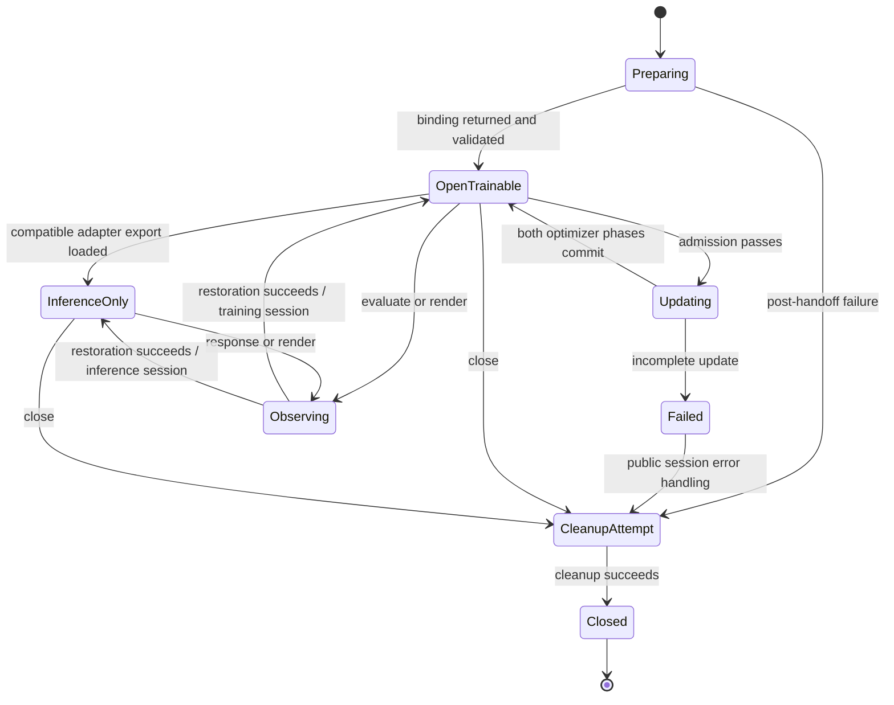

# Implicit state machines in Particle Sliders

Audited `HyperGAN/particle-sliders` **main at `2b212c108637ca996d7676664547056066f2b22c`**, fetched 2026-11-06. The source is isolated on `audit/implicit-state-machines-20261106`.

The app's state machines are mostly encoded in **flags, mutable model methods, context-manager lifetimes, optimizer progress, filesystem markers and child-process ownership**. Some have status strings, but no centralized definition of legal transitions. The most important boundaries are ownership, partial failure, durable commit and recovery.

## Inventory

Each entry identifies state carriers, states/events, guards, failure/retry behavior and source evidence. Equivalent backend implementations are grouped. Nested protocols are listed separately when they have different ownership or commit boundaries; these are not a count of mutually independent machines.

| Area | Inventory | Main protocols |
|---|---|---|
| Shared API and execution | [C01–C26](core.md) | Backend preparation/handoff, packet admission, session usability/close, update admission, observer callbacks, transactional restore, observation rollback, resource leases, exports, file commits, subprocess control, checkpoints, reporter readiness/replay/tailing/termination. |
| Training and numerical execution | [T01–T21](training.md) | D/G commit phases, poisoned updates, inference-only engines, sampler/RNG continuation, historical games, signal-driven stopping, checkpoint publication, fresh-history admission, auxiliary critics/miners, early stopping, caches, trajectory refresh, global recipe mutations, remaining weight EMA. |
| Adapters and native generation | [A01–A27](adapters.md) | Attach/patch ownership, strength/envelope scopes, exact OFF behavior, PEFT scaling baselines, shared particle banks, checkpoint loads, backend placement/freeze/eval, checkpoint recomputation, teacher caches, capture/replay hooks, stage-specific generation, condition/attention intervention. A15 is contextual admission, A16–17 cross-reference C entries, and A27 is fixture-only. |
| Pipelines, selection and research orchestration | [O01–O35](orchestration.md) | Artifact-driven pipeline stages, listening/calibration, immutable benchmarks, durable queues, GPU leases, train/render campaigns, finalist search, distillation/package/publication, render claims, staged evaluation, confirmation and evidence archives. Includes historical derived verdicts as contextual guards. |

The [fix PR tracker](fix-prs.md) links each priority finding to its reviewed fix and records validation, review findings and merge commits.

## Findings to address first

These are source-verified control-flow findings. They were not exercised against models, GPUs, services or live jobs.

1. **Finalist rendering can deadlock on its own GPU lock.** `render_finalists` holds all acquired locks until after its launch loop. With more unfinished finalists than GPUs, it tries to acquire a GPU lock it still owns through an earlier file descriptor. Child exit does not release the parent's descriptor. See **O15** and [search_yue2_critic.py:120](https://github.com/HyperGAN/particle-sliders/blob/2b212c108637ca996d7676664547056066f2b22c/scripts/search_yue2_critic.py#L120). The needed state distinction is GPU lease free/running/reaped/released before another launch.

2. **Several adapter scopes erase the outer scope's activation.** Native/legacy LoRA, DoRA and H3/LTX variants reset strength to zero on exit rather than restoring the previous effective strength. Nested scopes therefore leave an outer active scope at zero. Named PEFT and YuE2 already provide restoration patterns. See **A02/A06/A08** and [native_lora.py:392](https://github.com/HyperGAN/particle-sliders/blob/2b212c108637ca996d7676664547056066f2b22c/packages/particle-sliders-core/src/particle_sliders/native_lora.py#L392).

3. **Older games can remain partially updated without a failed-state latch.** BISPF and several historical D/G helpers commit D before G can fail. Their completed count can remain unchanged while D weights/optimizer/RNG have advanced. The modern conditional engine explicitly latches failure and blocks checkpoint/continuation; the older helpers do not uniformly do so. See **T01/T05–T09/T16** and [bispf_game.py:136](https://github.com/HyperGAN/particle-sliders/blob/2b212c108637ca996d7676664547056066f2b22c/packages/particle-sliders-core/src/particle_sliders/bispf_game.py#L136).

4. **A claimed SQLite job can become permanently stranded.** Reward-search jobs move pending → running, but the queue has no lease/reclaim transition. Worker failure can leave running jobs that the next worker never claims. Catalog workers have different retry rules; failed jobs remain skipped until explicit intervention. See **O11/O24** and [reward_search/queue.py:27](https://github.com/HyperGAN/particle-sliders/blob/2b212c108637ca996d7676664547056066f2b22c/packages/particle-sliders-core/src/particle_sliders/textsliders/reward_search/queue.py#L27).

5. **Attempted, committed and durable are different states in several workflows.** Calibration records `last_fit` before a fit succeeds, suppressing an identical retry after failure (**O06**). Research decisions can precede evidence archival (**O28**); partial package directories can block a retry (**O35**). Worker result files can precede cleanup/exit; common controller completion correctly checks process exit (**C20/C21/C26**). Existing directory/file presence must not stand in for a completed transaction.

6. **`main` still exposes forbidden weight-EMA paths.** The shared lifecycle supports optional weight shadows and averaged selection; Music3-particle and Tiny/Bonsai bridge trainers still unconditionally initialize/update/export averaged weights. This conflicts with the supplied standing instruction. See **C13/T21**. This audit did not enable EMA, alter historical artifacts, or change the official upstream scalar optimizer statistics.

7. **Attachment and loading have mixed rollback guarantees.** Some adapters destructively patch live forwards or copy tensors before a later validation error, leaving partially changed hosts. Cleanup failure can also leave a session flagged open. See **A01/A09–A11/A25/C03/C07**. Attach/load/observe/close failures need distinct recovery contracts.

## The central lifecycle

This is a map of the main ownership boundary, not a replacement specification. Cleanup/restoration failures can leave partially restored resources without a dedicated state flag. Open/closed, game healthy/failed, adapter strength, export-only status, completed updates, durable checkpoint progress and reporter status are independent dimensions. Recoverable restore of an open disabled game differs from reopening a session that was closed on an update error.

## Coverage and verification

- Static source/AST sweep: **453 Python files / 96,120 lines** across installed package source, compatibility entrypoint, pipeline, selection, scripts and examples. Detailed evidence links cover **116 files**. Repeated families were grouped; the coverage file distinguishes source scanning from cited evidence.
- [Coverage manifest](coverage.json) records paths, source hashes, line counts, parse results, linked evidence and exclusions. Every Python file in those roots parsed successfully. Source-link start lines and report links were checked locally.
- The baseline audit used no application imports, model loading, training, GPU allocation, services or runtime tests. Its additions are documentation and the source manifest. Subsequent fix-branch tests are recorded separately in the [fix PR tracker](fix-prs.md).
- Archived `analysis/`/`legacy/` experiments, generated/static assets, external products/dependency internals and retired Fibo are excluded except where a compatibility interface is referenced. Fixture-only tokenizer state is explicitly separated. This is a comprehensive static inventory of the scoped app workflows, not a proof that every possible dynamic state has been discovered.
- Historical research selection, preservation/media gates, early stopping and EMA branches are documented as existing behavior. They do not supersede the current sole RAW FP64 operand-first equal-example relative-SSE metric, fixed declared budgets, raw-weight rule or official optimizer formula.

See [the 2026-11-07 shared-boundary and follow-up PR tracker](followups-20261107.md) for the subsequent separate `develop` PRs and new cohort validation.
