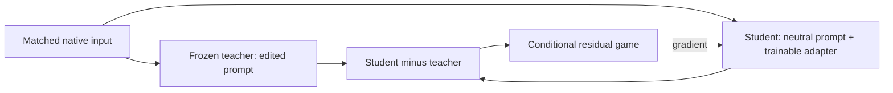

# Teacher/student training and the particle game

A slider transfers an intended edit into a small adapter while leaving a large
base model frozen. The product defines the edit, matched inputs, target response
and conditioning. Core runs the adversarial game over those responses.

## 1. Construct a matched teacher/student pair

Consider “a red cup” and “a shiny red cup.” For a diffusion model, the product
can give both passes the same noisy latent and timestep. The frozen teacher uses
the edited prompt; the student uses the neutral prompt with its adapter active.
This isolates the intended difference instead of comparing unrelated samples.

Write the actual frozen target as $T_i$, the unadapted neutral response as $N_i$,
and the adapted student's response as $S_\theta(i)$. The teacher and student
need not be two full model copies: the same frozen base can serve both roles by
switching the adapter off for teacher capture. Teacher targets are detached.
The student pass must retain gradients to its adapter even though base weights
are frozen.

A response is a native model tensor, such as a diffusion velocity field or an
autoregressive hidden vector. It is not necessarily a finished image or waveform.
An autoregressive product might match prompt/history positions; it owns that
alignment and any guided or signed teacher construction. Here $T_i$ always means
the **actual training target**, including those product choices.

At an ordinary LoRA linear layer, the learned branch has the form

$$
y = W_0x + s\,\frac{\alpha}{r}BAx.
$$

$W_0$ stays frozen; $A$ and $B$ are trainable, $r$ is adapter rank, and $s$ is
slider strength. Routed adapters may additionally use a trainable particle bank
$P$. Scaling a branch does not make the complete nonlinear model or sampled
output linear in $s$. Products declare strength ranges and their OFF semantics;
in particular, numeric zero in stock PEFT still evaluates the branch and is not
a universal bypass guarantee. See [PEFT scaling](../packages/particle-sliders-core/PEFT-SCALING.md).

## 2. Turn the response difference into a conditional game

For a fixed positive response scale $a$, define

$$
e_i = (S_\theta(i)-T_i)/a.
$$

Draw a Gaussian reference with the native response shape:

$$
n_i\sim\mathcal N(0,\sigma^2I),\qquad
x_{r,i}=n_i,\qquad x_{f,i}=n_i+e_i.
$$

The critic $D_\phi(x,c_i)$ receives either reference together with the same
condition $c_i$. Conditions can encode timestep, sign, strength and context.
They must describe the task; a row ID by itself does not explain how an edit
should transfer to unseen examples.

If $S_\theta(i)=T_i$, the residual vanishes and the real/fake pair is identical.
Otherwise, the critic learns directions that distinguish the residual-shifted
reference, and the student learns through the critic to remove that distinction.
The reference is shared within each pair. Critic and generator update phases
have independent row and reference-noise streams.

This is teacher/student matching through an adversarial response game. The
squared response error used for evaluation below is **not** an additional MSE,
reconstruction, or distillation term in the training loss.

## 3. Alternate critic and adapter updates

For the default `bispf_optimized` recipe, ParticleGAN 0.9.5 supplies a
Sinkhorn-relativistic loss. Let $r_i=D_\phi(x_{r,i},c_i)$ and
$f_j=D_\phi(x_{f,j},c_j)$ be the raw logits in a batch of size $B$.
The upstream Sinkhorn coupling gives weights $\Pi_{ij}$. Its reported
adversarial loss values are

$$
\mathcal A_D=B\sum_{ij}\Pi_{ij}\operatorname{softplus}(f_j-r_i),
\qquad
\mathcal A_G=B\sum_{ij}\Pi_{ij}\operatorname{softplus}(r_i-f_j).
$$

The matched teacher/student inputs above and this minibatch coupling are two
different pairings. The coupling is part of the upstream loss, not a replacement
for aligned teacher capture. Upstream also controls coupling construction,
gradient scaling, penalties and optimizer geometry; these scalar formulas alone
are not a reimplementation of its update rule.

The shared engine performs:

1. **Critic update:** detach the student's generated response, then optimize
   $\mathcal L_D=\mathcal A_D+\mathcal R_D$, where $\mathcal R_D$ is the recipe's
   critic penalty.
2. **Generator update:** freeze critic parameters while retaining gradients
   through its input. Optimize $\mathcal L_\theta=\mathcal A_G+\mathcal R_P(P)$
   over the adapter and, if present, the participating particle bank.
3. Mark a completed step only after both phases finish.

$\mathcal R_P$ is the recipe's particle regularizer when a real bank participates;
an adapter-only game uses `particles=None`. A disconnected dummy bank is not a
particle model. Core uses ParticleGAN's public loss, regularizer,
constraint-geometry backward and optimizer APIs. It does not substitute a local
optimizer formula. See the [engine contract](../packages/particle-sliders-core/CONDITIONAL-PG09-CONTRACT.md)
and [pinned release](../packages/particle-sliders-core/COMPATIBILITY-PG095.md).

Weight EMA is disabled for the adapter, critic and bank. Training, selection and
exports use raw current weights. Upstream scalar optimizer statistics stay as
specified by ParticleGAN.

## 4. Evaluate without confusing the metric with the objective

The default search proxy measures how closely the raw student matches its
teacher relative to the teacher's edit away from neutral:

$$
E_i=\frac{\sum_k(S_\theta(i)_k-T_{i,k})^2}
          {\sum_k(T_{i,k}-N_{i,k})^2},\qquad
E=\frac1m\sum_{i=1}^m E_i.
$$

Pool all declared positions and coordinates within each example, divide within
that example, then average examples equally. Lower is better. OFF has error one
when $S=N$ and teacher edit energy is positive; an exact match has error zero.
For a scalar example with neutral 0, teacher 2 and student 1, the relative
error is $(1-2)^2/(2-0)^2=1/4$.
An error above one remains a valid, worse score. A zero denominator is undefined,
not zero error. The implementation converts the original operands to CPU FP64
before subtracting and preserves chunk-independent sums.

This is an accepted proxy for the learned effect. A separate, explicitly declared
objective can instead measure the intended effect in matched finished outputs:

$$
G=\frac1m\sum_i\bigl[I(O_i^{\mathrm{ON}})-I(O_i^{\mathrm{OFF}})\bigr],
$$

using a fixed instrument $I$, matched cases and controlled sampling; higher gain
is better. Output-effect measurement is an **optional improvement**, not a
prerequisite for using proxy search or its existing results. It does not require
new training or confirmation. Do not mix the two metrics inside one ranking or
relabel historical scores. The current [search runner](../packages/particle-sliders-core/PARAMETER-SEARCH.md)
implements its declared relative-error protocol.

## What the product must get right

The mathematics assumes that teacher and student share the declared example,
response coordinates and condition; target capture is frozen; adapter gradients
are live; and the optimizers own only the intended trainables. Core can validate
shapes, identities, state transitions and optimizer ownership. Only the product
can establish that the chosen native response and teacher construction represent
the intended edit. Native generation and effect measurements belong in the
[product repositories](products.md).
